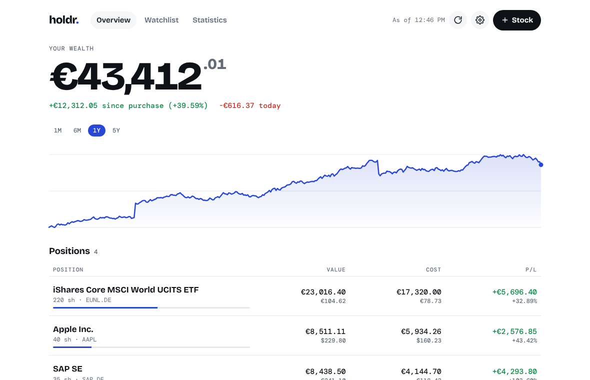
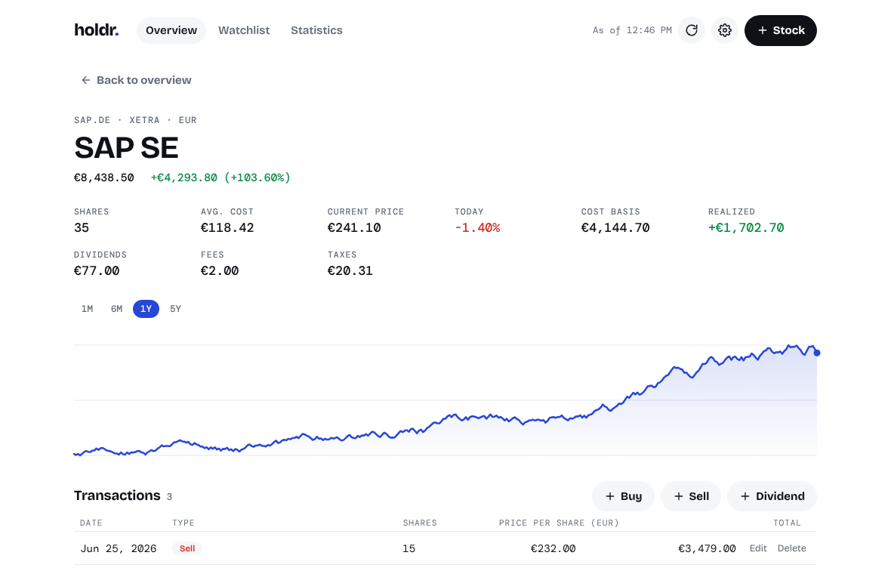
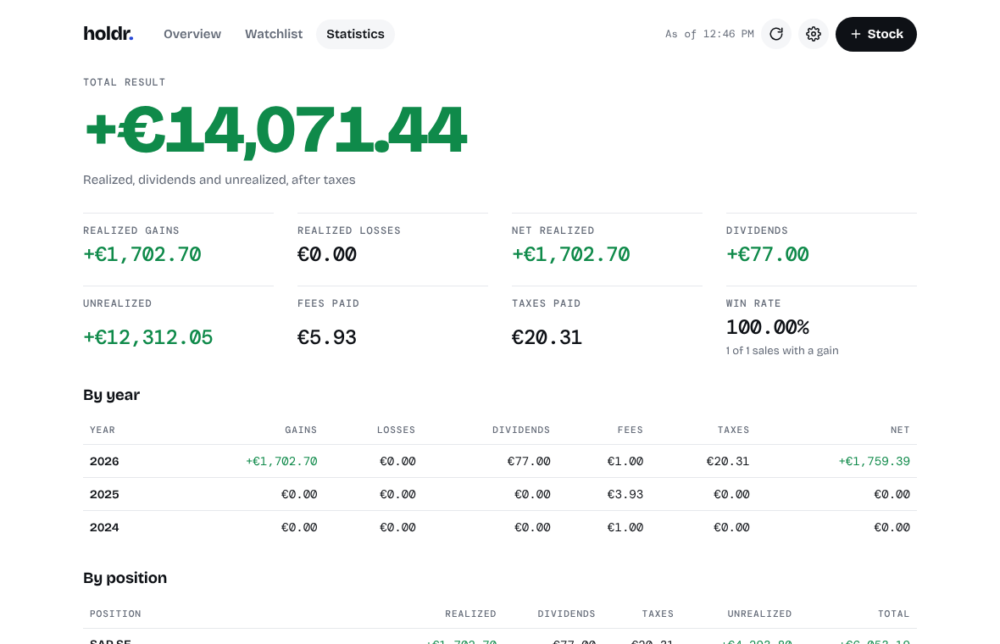
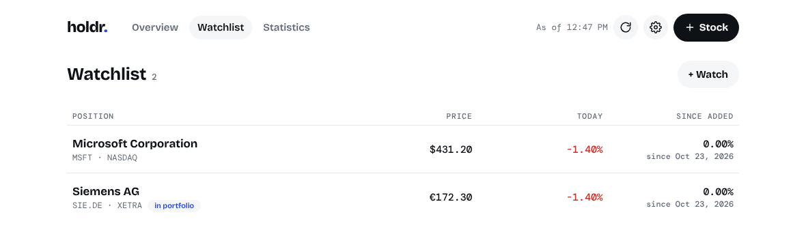

<p align="center">
  
</p>

<h1 align="center">Holdr</h1>

<p align="center">
  <strong>Your portfolio. On your computer.</strong><br>
  A private stock and ETF tracker for Windows and macOS – no account, no cloud, no telemetry.
</p>

<p align="center">
  <a href="../../releases/latest"><strong>Download</strong></a> ·
  <a href="#features">Features</a> ·
  <a href="#privacy">Privacy</a> ·
  <a href="README.de.md">Deutsch</a>
</p>

<p align="center">
  <picture>
    <source media="(prefers-color-scheme: dark)" srcset="docs/images/overview-dark.png">
    
  </picture>
</p>

## Features

- **See your wealth at a glance** – total value, result since purchase, today's change and a value chart over 1 month to 5 years.
- **Buys, sells, dividends and splits** – as many transactions per stock as you like, with fees and taxes kept apart, including fractional shares.
- **Dividends and splits spotted for you** – Holdr finds payouts and splits of your holdings that you have not recorded yet; you check them and add them with one click.
- **Honest statistics** – realized gains and losses (FIFO), dividends, fees and taxes, in total, per year and per position.
- **How diversified am I?** – your portfolio by sector and by country; ETFs are split by their sector weights.
- **Upcoming dates** – next ex-dividend date, payment date and earnings report for each position.
- **Watchlist** – follow stocks you don't own yet, with the change since you added them.
- **Stocks and ETFs worldwide** – search by name, ticker or ISIN, e.g. on XETRA, Vienna, NASDAQ or NYSE.
- **Euro or US dollar** – other currencies are converted automatically.
- **Backup in one click** – save all data to a file and restore it, also to move between Windows and Mac.
- **Works offline** – shows the last loaded prices; light and dark mode; German and English.

<table>
  <tr>
    <td width="33%">
      <picture>
        <source media="(prefers-color-scheme: dark)" srcset="docs/images/position-dark.png">
        
      </picture>
      <p align="center"><sub>Position detail</sub></p>
    </td>
    <td width="33%">
      <picture>
        <source media="(prefers-color-scheme: dark)" srcset="docs/images/statistics-dark.png">
        
      </picture>
      <p align="center"><sub>Statistics</sub></p>
    </td>
    <td width="33%">
      <picture>
        <source media="(prefers-color-scheme: dark)" srcset="docs/images/watchlist-dark.png">
        
      </picture>
      <p align="center"><sub>Watchlist</sub></p>
    </td>
  </tr>
</table>

<sub>All screenshots show made-up sample data.</sub>

## Download

Get the latest version from the **[Releases page](../../releases/latest)**:

| System | File | Requirements |
| --- | --- | --- |
| Windows | `Holdr-Windows-Setup.exe` (or `Holdr-Windows.msi`) | Windows 10 or 11, 64-bit |
| macOS | `Holdr-macOS.dmg` (Apple Silicon and Intel) | macOS 11 Big Sur or later |

Holdr is not code-signed yet, so your system warns you on first launch:

- **Windows:** in “Windows protected your PC”, click **More info → Run anyway**.
- **macOS:** right-click Holdr in Applications → **Open → Open**, or allow it under
  System Settings → Privacy & Security → **Open Anyway**.

## Privacy

Holdr is built to keep your financial data to yourself.

- Your positions, transactions, watchlist and settings are stored **only on your computer**, in one
  SQLite file. There is no account, no server and no telemetry.
- To get prices, dividends, splits, sectors and dates, Holdr requests data from **Yahoo Finance**. It
  sends only your search terms and the ticker symbols of your positions, watchlist and required
  exchange rates – never share counts, purchase prices or amounts. As with any internet request, Yahoo
  sees your IP address. For sectors and dates, Yahoo requires a session cookie; Holdr keeps it in memory
  only and discards it when you quit.
- On Windows, Holdr uses Microsoft's WebView2 runtime for display; whether it sends diagnostic data to
  Microsoft depends on your Windows settings.

**Where is my data?** Windows: `%APPDATA%\app.holdr.desktop\holdr.db` ·
macOS: `~/Library/Application Support/app.holdr.desktop/holdr.db`.
Use **Settings → Backup** to save a copy or move to another computer.

## Good to know

- Realized gains use the **FIFO** method. Tax rules differ by country (Austria, for example, uses the
  moving average price), so your broker's statements are authoritative for your taxes.
- Foreign currencies are converted at the current exchange rate.
- Prices may be delayed by about 15 minutes, depending on the exchange.
- Holdr is a tool for your own overview and **not investment advice**.

## Build from source

You need Node.js 22+, Rust and the [Tauri prerequisites](https://v2.tauri.app/start/prerequisites/).

```bash
cd app
npm ci
npm run desktop:dev            # run the app
npm run desktop:build:windows  # or desktop:build:mac
```

Contributions are welcome.

## About

Holdr was developed with the help of [Claude](https://claude.com), an AI assistant by Anthropic.

## License

Holdr is free software under the [GNU General Public License v3.0](LICENSE). It comes with absolutely
no warranty. Third-party components and their licenses are listed in the app under
Settings → Open source licenses.

Market data is provided by Yahoo Finance, whose terms do not permit commercial use. Holdr is therefore
offered free of charge only.
